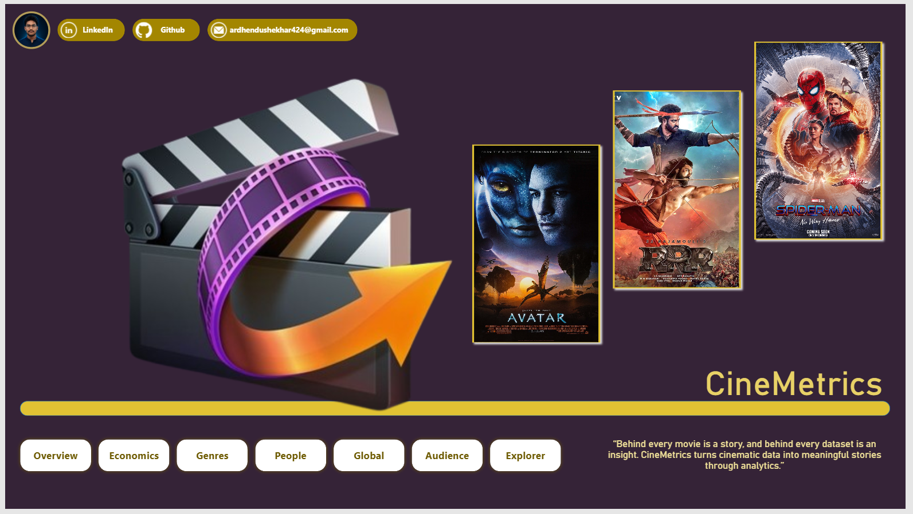
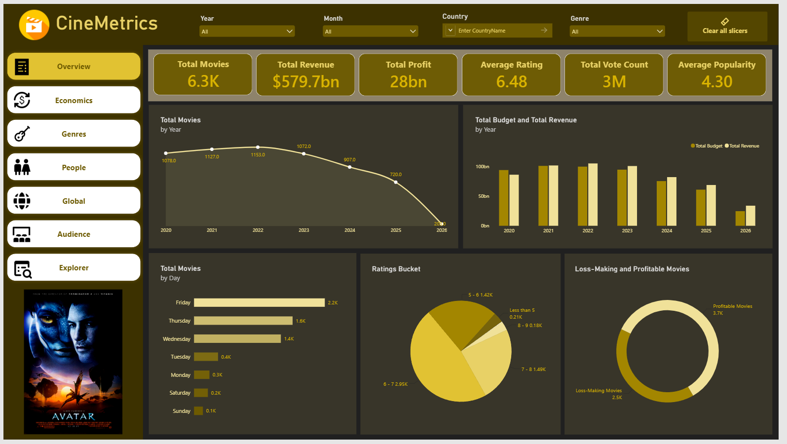
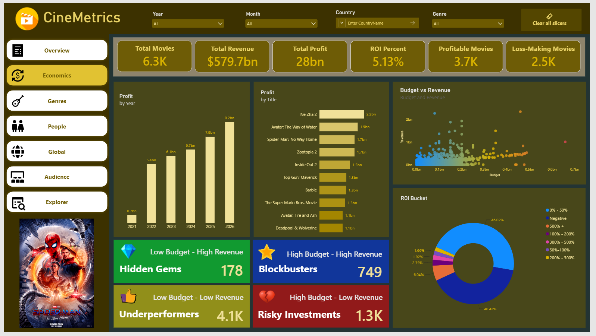
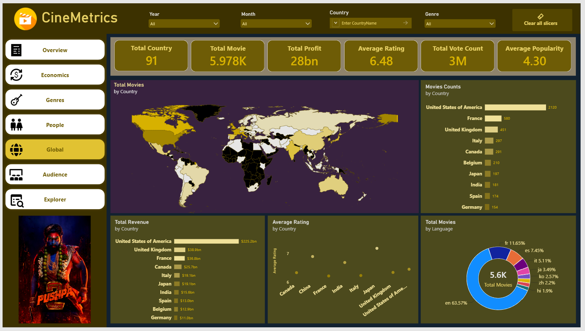
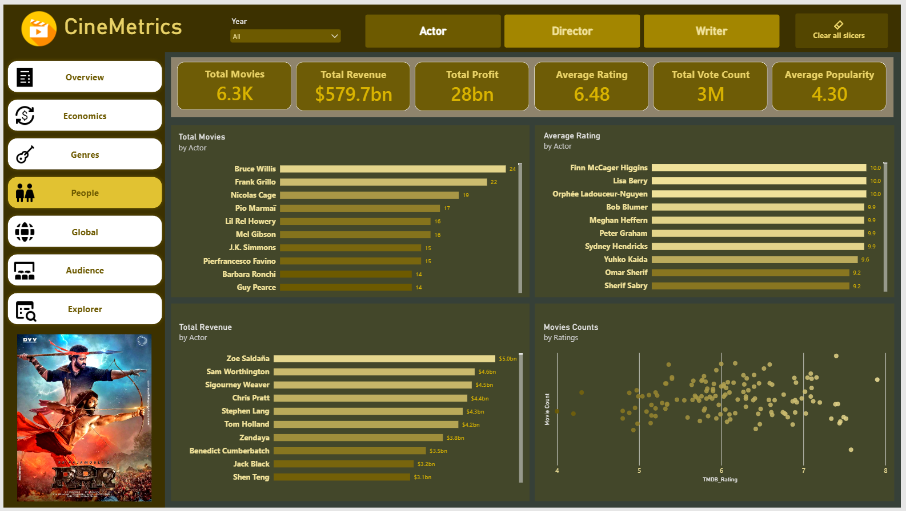
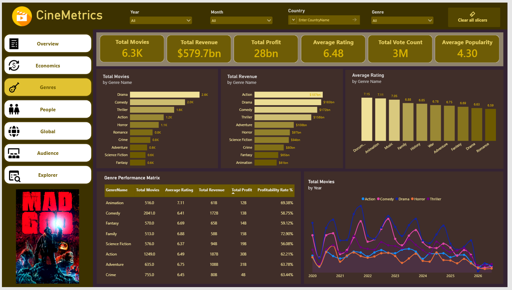

# 🎬 CineMetrics – Movie Analytics & Insight Platform (2020–2026)


**Transforming Movie Industry Data into Meaningful Insights with Python, SQL Server & Power BI**

CineMetrics is an end-to-end movie analytics and business intelligence project designed to explore the global film industry from 2020 to 2026. The project transforms raw movie data into a structured analytical data warehouse and interactive Power BI dashboards to uncover insights into box office performance, profitability, audience ratings, movie trends, genres, actors, directors, and production companies.

The platform combines data collection, enrichment, preprocessing, ETL automation, dimensional data modeling, SQL analytics, and interactive visualization to provide a comprehensive view of the modern movie industry.

---



[**Click to View Full DashBoard**](https://app.powerbi.com/view?r=eyJrIjoiZDMwZGEwNGEtNmY1YS00ODE2LWExNjctMzA4MTc2ZTA1ZDM3IiwidCI6ImJjMmRjNzNhLWZhM2QtNGNiZS1iZGM4LWI0NjhjNDY0NjM2ZiJ9&pageName=e756fddd3c0ba75bc51e)

## 📌 Project Overview

The movie industry generates enormous amounts of data, but understanding the relationship between financial performance, audience engagement, production characteristics, and movie trends requires more than raw datasets.

CineMetrics addresses this challenge by building a complete data analytics pipeline that converts movie datasets into actionable insights.

The project covers:
- Movie industry analysis from 2020 to 2026.
- Box office performance, budget, revenue, profit, and ROI analysis.
- Genre-wise and year-wise movie trends.
- Audience ratings, popularity, and voting patterns.
- Actor, director, writer, and production company analysis.
- Interactive business intelligence dashboards.



[**Click to View Full DashBoard**](https://app.powerbi.com/view?r=eyJrIjoiZDMwZGEwNGEtNmY1YS00ODE2LWExNjctMzA4MTc2ZTA1ZDM3IiwidCI6ImJjMmRjNzNhLWZhM2QtNGNiZS1iZGM4LWI0NjhjNDY0NjM2ZiJ9&pageName=e756fddd3c0ba75bc51e)

## 🎯 Project Objectives

- Collect and consolidate movie information from multiple data sources.
- Clean, transform, and enrich movie datasets using Python.
- Handle missing financial information using verified external data.
- Develop an automated ETL pipeline for data preparation.
- Design a dimensional data warehouse using SQL Server.
- Implement analytical SQL queries for business insights.
- Develop interactive Power BI dashboards using DAX.
- Identify patterns in movie production, financial performance, and audience engagement.

## 🛠️ Technology Stack

| Technology | Purpose |
|---|---|
| Python | Data extraction, cleaning, enrichment, and ETL |
| Pandas | Data manipulation and preprocessing |
| IMDb | Movie identifiers and metadata |
| TMDB API | Movie details, financial data, ratings, and credits |
| SQL Server | Data warehouse and analytical queries |
| SQL | Data modeling, transformations, and analysis |
| Power BI | Interactive dashboards and visualization |
| DAX | Measures, KPIs, and analytical calculations |
| Power Query | Data transformation and preparation |
| Excel / CSV | Dataset storage and intermediate processing |
| Git & GitHub | Version control and project documentation |



[**Click to View Full DashBoard**](https://app.powerbi.com/view?r=eyJrIjoiZDMwZGEwNGEtNmY1YS00ODE2LWExNjctMzA4MTc2ZTA1ZDM3IiwidCI6ImJjMmRjNzNhLWZhM2QtNGNiZS1iZGM4LWI0NjhjNDY0NjM2ZiJ9&pageName=e756fddd3c0ba75bc51e)

## 🔄 Project Workflow

The project follows an end-to-end data analytics workflow:

1. **Data Collection:** Consolidated movie datasets covering 2020–2026 using IMDb and TMDB-related data sources.
2. **Data Cleaning:** Used Python and Pandas to handle missing values, duplicates, inconsistent formats, and data quality issues.
3. **Data Enrichment:** Integrated additional movie information through TMDB API using IMDb and TMDB identifiers. Enriched financial fields with verified values where available.
4. **ETL Pipeline:** Developed Python scripts to extract, transform, validate, and prepare structured datasets for SQL Server.
5. **Data Warehousing:** Designed a dimensional data warehouse using fact, dimension, and bridge tables.
6. **SQL Analytics:** Created analytical queries to examine movie performance, financial metrics, audience engagement, and industry trends.
7. **Power BI Visualization:** Developed interactive dashboards with DAX measures, KPIs, filters, rankings, and time-based analysis.

## 🗄️ Data Warehouse Architecture

Designed a structured SQL Server data warehouse using a dimensional modeling approach.

**Fact Table**
- `fact_movie` – Central fact table containing movie-level information, financial metrics, ratings, popularity, and relevant dimension keys.

**Dimension Tables**
- `dim_date`
- `dim_genre`
- `dim_actor`
- `dim_director`
- `dim_writer`
- `dim_country`
- `dim_language`
- `dim_production_company`

**Bridge Tables**
- `bridge_movie_genre`
- `bridge_movie_actor`

The architecture supports analytical queries across multiple dimensions while handling many-to-many relationships between movies, genres, and actors.



[**Click to View Full DashBoard**](https://app.powerbi.com/view?r=eyJrIjoiZDMwZGEwNGEtNmY1YS00ODE2LWExNjctMzA4MTc2ZTA1ZDM3IiwidCI6ImJjMmRjNzNhLWZhM2QtNGNiZS1iZGM4LWI0NjhjNDY0NjM2ZiJ9&pageName=e756fddd3c0ba75bc51e)

## 📊 Dataset Overview

The project processes approximately **6,260 movie records** covering 2020–2026.

Key dataset attributes include:

- Movie ID, title, and release date
- Genres and original language
- Budget, revenue, profit, and financial performance
- IMDb ratings, TMDB ratings, and vote counts
- Popularity and runtime
- Directors and writers
- Top cast members
- Production companies and production countries

**Data Warehouse Scale:**
- 6,260 movie records in the fact table
- 18,442 actors in the actor dimension
- 30,593 movie-actor relationships
- 19 genres
- 4,700 directors
- 4,933 writers
- 3,121 production companies

## 📈 Key Business Metrics & KPIs

CineMetrics focuses on the following analytical measurements:

**Financial Performance**
- Total Movie Budget
- Total Box Office Revenue
- Total Profit
- Average Movie Budget
- Average Revenue per Movie
- Return on Investment (ROI)
- Profit Margin Percentage

**Movie Industry Trends**
- Total Movies Released
- Movies Released by Year
- Genre Distribution
- Production Trends
- Country-wise Movie Production

**Audience Engagement**
- Average IMDb Rating
- Average TMDB Rating
- Total Votes
- Movie Popularity
- Rating and Popularity Comparisons

**People & Production Analysis**
- Top Actors by Movie Appearances
- Top Directors by Movie Count
- Genre-wise Performance
- Production Company Analysis



[**Click to View Full DashBoard**](https://app.powerbi.com/view?r=eyJrIjoiZDMwZGEwNGEtNmY1YS00ODE2LWExNjctMzA4MTc2ZTA1ZDM3IiwidCI6ImJjMmRjNzNhLWZhM2QtNGNiZS1iZGM4LWI0NjhjNDY0NjM2ZiJ9&pageName=e756fddd3c0ba75bc51e)

## 📊 Power BI Dashboard

The Power BI component transforms the processed data warehouse into an interactive movie industry analytics experience.

The dashboard focuses on:
- Financial and box office performance.
- Movie release and genre trends.
- Audience ratings and popularity.
- Actor and director performance.
- Production company and country comparisons.
- Interactive filtering, ranking, and time-based analysis.

DAX measures and interactive visual elements help users explore the relationships between movie characteristics, financial success, and audience engagement.

## 💡 Key Project Highlights

- Built an end-to-end data analytics pipeline using Python, SQL Server, and Power BI.
- Integrated IMDb and TMDB-related datasets to create a consolidated movie database.
- Developed a Python-based data enrichment process to improve missing financial information using verified external data.
- Designed a dimensional data warehouse with fact, dimension, and bridge tables.
- Processed over 6,000 movies and established more than 30,000 movie-actor relationships.
- Applied SQL and DAX to develop analytical metrics and interactive business intelligence dashboards.
- Transformed complex movie industry data into meaningful and accessible insights.

## 📂 Project Structure

The repository is organized into dedicated sections for data, scripts, SQL development, and analytics.

```text
CineMetrics-Movie-Analytics-and-Insight-Platform/
├── dashboards/
│   ├── docs/
│   │   ├── ideas.md
│   │   └── tips.md
│   ├── images/
│   │   ├── Avatar.jpeg
│   │   ├── cover.png
│   │   ├── icon.png
│   │   ├── icons8-audience-48.png
│   │   ├── icons8-broken-heart-48.png
│   │   ├── icons8-diamond-48.png
│   │   ├── icons8-economy-50.png
│   │   ├── icons8-explorer-48.png
│   │   ├── icons8-genre-60.png
│   │   ├── icons8-global-48.png
│   │   ├── icons8-like-100.png
│   │   ├── icons8-overview-64.png
│   │   ├── icons8-people-48.png
│   │   ├── icons8-star-48.png
│   │   ├── RRR.jpg
│   │   └── Spider-Man_No_Way_Home.webp
│   └── CineMetrics.pbix
├── data/
│   ├── processed/
│   │   ├── cinemetrics_financial_enrichment_log.csv
│   │   ├── cinemetrics_movies_2020_2026.csv
│   │   ├── cinemetrics_movies_2020_2026_enriched.csv
│   │   └── cinemetrics_movies_2020_2026_with_backdrops.csv
│   └── raw/
│       └── movies_raw.csv
├── dataset_builder/
│   ├── build_dataset.py
│   ├── download_tmdb_dataset.py
│   ├── process_tmdb_dataset.py
│   └── README.md
├── notebook/
│   └── movie.ipynb
├── scripts/
│   ├── enrich_financials.py
│   ├── fetch_backdrops_posters.py
│   └── load_staging.py
├── sql_analysis/
│   ├── 01_create_schemas.sql
│   ├── 02_create_staging_table.sql
│   ├── 03_create_dimensions.sql
│   ├── 04_create_bridge_tables.sql
│   ├── 05_create_fact_table.sql
│   ├── 06_create_indexes.sql
│   ├── 07_test_database.sql
│   ├── 08_preprocess.sql
│   ├── 09_load_dimensions_tables.sql
│   ├── 10_Load_fact_table.sql
│   ├── 11_load_bridge_tables.sql
│   ├── 12_analysis.sql
│   ├── analysis.md
│   └── sql_analysis.slnx
├── test/
│   └── test_final_csv.py
├── .env
├── .gitignore
├── generate_tree.py
├── LICENSE
├── README.md
├── requirements.txt
└── tree_structure.txt
```



[**Click to View Full DashBoard**](https://app.powerbi.com/view?r=eyJrIjoiZDMwZGEwNGEtNmY1YS00ODE2LWExNjctMzA4MTc2ZTA1ZDM3IiwidCI6ImJjMmRjNzNhLWZhM2QtNGNiZS1iZGM4LWI0NjhjNDY0NjM2ZiJ9&pageName=e756fddd3c0ba75bc51e)

## 🚀 Project Outcome

CineMetrics demonstrates the complete journey from raw movie datasets to a structured data warehouse and interactive business intelligence solution.

It showcases practical skills in data collection, data engineering, ETL development, data modeling, SQL analytics, financial analysis, DAX calculations, and dashboard development.

The project provides a scalable foundation for further exploration of movie industry trends and data-driven decision-making.

---

**Developed as a Data Analytics Portfolio Project**

**Technologies:** Python | Pandas | IMDb | TMDB API | SQL Server | Power BI | DAX | Power Query

<table border="0" cellpadding="0" cellspacing="0" width="100%">
  <tr>
    <!-- Left Column: Isolated Profile Image Container -->
    <td width="190" align="center" valign="top">
      
    </td>
    <!-- Right Column: Content Container -->
    <td valign="top" style="padding-left: 20px;">
      <!-- H2 header stays here, keeping the line securely isolated from the left cell -->
      <h2>Ardhendu Shekhar Behera</h2>
      <p><em>Data Scientist & Machine Learning Engineer passionate about turning complex data into actionable AI solutions.</em></p>
      <p>
        📧 <a href="mailto:asbpintu@gmail.com">asbpintu@gmail.com</a> &nbsp;|&nbsp; 
        💼 <a href="https://www.linkedin.com/in/asbpintu/">LinkedIn</a> &nbsp;|&nbsp; 
        🌐 <a href="https://asbpintu.netlify.app">Portfolio Website</a>
      </p>
    </td>
  </tr>
</table>

<p>
  
  
  
  
  
  
</p>
